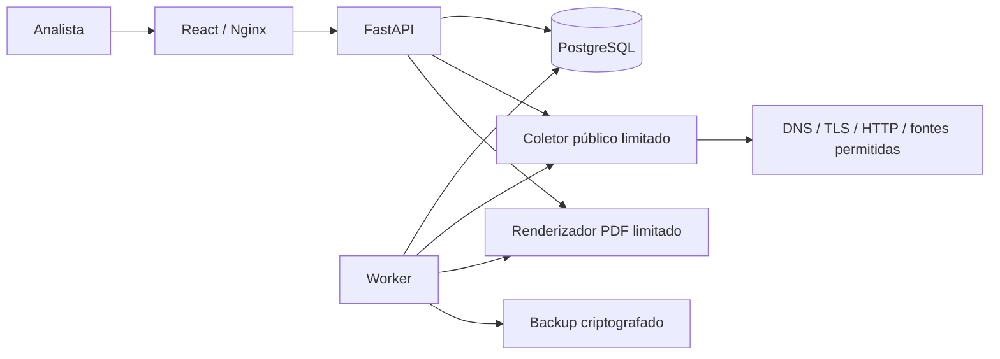

<div align="center">

# BetHunter

**Inteligência de fontes públicas para investigação de plataformas de apostas**

Projeto pessoal de [Yuurih44](https://github.com/Yuurih44), desenvolvido para estudar e aplicar engenharia de software, segurança de aplicações e OSINT em um fluxo de investigação documentado.

[Funcionalidades](#funcionalidades) · [Instalação](#instalação) · [Arquitetura](#arquitetura) · [Testes](#testes-e-validação) · [Documentação](#documentação)

</div>

---

## Sobre o projeto

O BetHunter reúne descoberta de candidatos, coleta técnica pública, avaliação explicável, organização de casos e exportação de relatórios. A interface escura segue uma organização inspirada em ferramentas SOC e Threat Intelligence, com indicadores calculados a partir dos registros do banco.

Este é um **projeto pessoal e independente**, em evolução. Não possui vínculo institucional com autoridades, órgãos reguladores ou plataformas comerciais. Seu propósito é apoiar pesquisa e revisão humana; não substituir análise jurídica ou investigação oficial.

> O score representa prioridade de investigação. O sistema não declara automaticamente que um domínio é ilegal ou que uma empresa cometeu crime. Ausência em uma lista, extensão do domínio e infraestrutura compartilhada não constituem prova de irregularidade.

## Funcionalidades

| Módulo | Recursos implementados |
|---|---|
| Dashboard | Inventário, análises, pendências, distribuição de scores e evolução com dados do banco |
| Análise de domínios | Normalização, DNS público, certificados TLS, redirecionamentos HTTP e indicadores de conteúdo |
| Avaliação | Fatores explicáveis, pesos configuráveis, regras versionadas e parecer humano |
| Fontes oficiais | Importação conservadora, registro de origem/data/hash, contexto regulatório e falhas explícitas |
| Descoberta | Fontes públicas permitidas, CSV/JSON/domains/hosts, deduplicação, fila, cotas e agendamentos |
| Threat Intelligence | Histórico das próprias coletas, relações domínio/IP/ASN e enriquecimento ASN opcional |
| Investigações | Casos, domínios associados, notas, prioridade, status e checklist de revisão |
| Relatórios | PDFs reais, snapshots, SHA-256, fila limitada e geração manual pela interface |
| Operação | Diagnóstico de worker/fontes/cotas, alertas e notificações com reconhecimento auditado |
| Contas | Convites, Argon2id, MFA TOTP, códigos de recuperação, sessões e recuperação por email |
| Recuperação | Backups criptografados, restauração em alvo separado e retenção opcional de PDFs |
| Proteção voluntária | Exportação de listas domains, hosts e Adblock para uso local autorizado |

A descoberta consulta fontes configuradas; não enumera toda a internet. Para novas contas, a fonte padrão usa consultas horárias com até 100 candidatos por consulta. A coleta respeita a cota padrão compartilhada de 100 tentativas por dia e intervalo mínimo de 30 segundos. Contas existentes podem aplicar esse perfil em **Descoberta automática**.

Nenhuma denúncia é enviada automaticamente. Um protocolo só é registrado como declaração do analista após confirmação obtida por ele no canal oficial.

## Tecnologias

- **Frontend:** React, TypeScript, Vite, Tailwind CSS, Lucide React, Recharts, React Router e Axios.
- **Backend:** Python 3.12+, FastAPI, SQLAlchemy, Pydantic, Alembic e HTTPX.
- **Dados:** PostgreSQL 16; SQLite isolado para testes locais.
- **Segurança e documentos:** Argon2id, TOTP, Fernet e WeasyPrint.
- **Infraestrutura:** Docker Compose, Nginx, HTTPS opcional com Caddy e GitHub Actions.

## Arquitetura



A aplicação separa provisionamento administrativo, migração e acesso de runtime ao PostgreSQL. A coleta valida destinos públicos a cada resolução/redirecionamento e fixa a conexão ao IP validado, preservando Host e SNI.

```text
bethunter/
├── backend/                 API, modelos, coleta, segurança, worker e migrações
├── frontend/                Interface React e cliente HTTP
├── database/                Modelo e SQL das migrações
├── docker/                  Imagens, Nginx e configuração HTTPS
├── docs/                    Operação, APIs, ameaças e evidências de validação
├── tests/                   Testes de API, negócio, segurança e operação
├── e2e/                     Smoke test de navegador para ambiente descartável
├── scripts/                 Inicialização, configuração, restore e empacotamento
├── .github/workflows/       Verificações de CI
├── .env.example             Configuração de exemplo, sem segredos
├── docker-compose.yml
└── iniciar.sh
```

## Instalação

### Linux / Kali — execução local

Requisitos: Python 3.12+ com venv, Node.js 22+, npm, binários PostgreSQL e bibliotecas nativas do WeasyPrint/Pango.

```bash
git clone https://github.com/Yuurih44/Bethunter.git
cd Bethunter
./iniciar.sh
```

O iniciador prepara dependências, build, banco privado, migrações, API, worker e SMTP local. Não execute com sudo. Acesse **http://localhost:8080**.

Para provisionar o administrador, substitua o email abaixo pelo seu. A senha é solicitada sem eco:

```bash
./iniciar.sh admin seu-email@exemplo.com
```

Após entrar, configure MFA em **Segurança da conta**. O cadastro padrão utiliza convites individuais.

```bash
./iniciar.sh status     # Verificar serviços
./iniciar.sh stop       # Parar preservando o banco
./iniciar.sh inbox      # Ler capturas do SMTP local
./iniciar.sh backup     # Gerar backup criptografado
```

Dados, logs e configuração privada da execução nativa ficam em `.runtime/`. Não envie esse diretório ao GitHub.

### Docker Compose — Linux ou Windows

Use Docker Engine com Compose v2 no Linux ou Docker Desktop com WSL2 no Windows. O configurador abaixo exige Python 3 no host; os serviços usam as dependências das imagens.

```bash
git clone https://github.com/Yuurih44/Bethunter.git
cd Bethunter
python3 scripts/configure.py
docker compose up --build -d
```

No Windows, execute os comandos pelo WSL2 ou utilize `python` no lugar de `python3`, conforme sua instalação.

```bash
docker compose exec backend python -m app.cli seu-email@exemplo.com
docker compose ps
```

Acesse **http://localhost:8080**. Para parar preservando os volumes:

```bash
docker compose down
```

**Não use `down -v` para atualizar uma instalação com dados.** Volumes de versões antigas podem exigir migração dos papéis PostgreSQL. Consulte [operação e atualização](docs/OPERATIONS.md) antes de atualizar.

### Configuração e email

O configurador gera os segredos ausentes em `.env`; o iniciador nativo mantém sua própria configuração em `.runtime/local.env`. Preserve as chaves e nunca publique esses arquivos.

O SMTP incluído é de **captura local para desenvolvimento**: não entrega mensagens na internet. Para entrega real, configure um provedor SMTP com STARTTLS e remetente autorizado. Produção também exige HTTPS, cookies seguros, confirmação real de email e chaves persistentes. Detalhes em [OPERATIONS.md](docs/OPERATIONS.md).

## Fluxo de uso

1. Provisione sua conta, entre e ative MFA.
2. Cadastre um domínio ou ative uma fonte em **Descoberta automática**.
3. Examine os fatores, as evidências, os erros de coleta e a situação regulatória.
4. Registre um parecer humano e organize os domínios em um caso.
5. Confira o checklist e use **Gerar e baixar PDF**.
6. Acompanhe notificações, filas e agendamentos. Encaminhamentos externos continuam manuais.

Uma coleta incompleta ou fonte indisponível permanece identificada. A plataforma não preenche lacunas com resultados fictícios.

## Testes e validação

Última suíte local registrada: **181 testes aprovados em PostgreSQL real, sem testes ignorados**. Build TypeScript/Vite, sintaxe Python e migrações SQLite passaram. Consulte os logs e as condições da execução em [VALIDATION.md](docs/VALIDATION.md).

Esses resultados não comprovam implantação validada em produção. PostgreSQL, restauração, navegador com Nginx, MFA, PDF e SMTP local foram exercitados. Ruff/Bandit passaram; npm audit e pip-audit não apontaram vulnerabilidades conhecidas nas versões consultadas após atualização. SMTP externo e HTTPS público ainda exigem provedor/domínio. Os quatro jobs do [CI remoto](https://github.com/Yuurih44/Bethunter/actions/runs/39075601322) passaram, incluindo PostgreSQL 16 e navegador em Docker. Veja o relatório para o escopo e as limitações.

```bash
# Na raiz, com dependências instaladas e banco de testes isolado:
python3 -m pytest -q

# Build completo do frontend:
cd frontend
npm ci
npm run build
```

Em ambientes restritos, o modo de teste em processo está documentado em [VERIFICATION.md](docs/VERIFICATION.md). **Nunca execute a suíte apontando para um banco com dados reais:** as fixtures recriam o esquema. Testes PostgreSQL exigem um banco exclusivo e autorização explícita de reset.

Fixtures sintéticas existem nos testes e no seed E2E explicitamente identificado, destinado a ambiente descartável. Não são resultados reais de investigação.

## Segurança e limitações

- Proteções implementadas: CSRF/origem, validação de entradas, consultas parametrizadas, isolamento por proprietário, perfis, sessões revogáveis e limites de autenticação/coleta.
- O coletor rejeita localhost, redes privadas, metadados e endereços reservados; revalida redirecionamentos e limita resposta, tempo e concorrência.
- O renderizador PDF não carrega recursos externos e opera em subprocesso com limites; isso não equivale a um sandbox completo do sistema operacional.
- O MVP pressupõe um backend e um worker. Escala, concorrência e rate limiting distribuído exigem validação adicional.
- Fontes oficiais e comunitárias podem mudar, falhar ou conter lacunas. O parser não interpreta arbitrariamente PDFs, decisões judiciais ou todas as jurisdições.
- Conteúdo dinâmico, notícias e páginas geolocalizadas podem gerar limitações e falsos positivos. Não há bypass de CAPTCHA, exploração ou acesso autenticado aos alvos.
- IP, CDN e ASN compartilhados não comprovam operador comum. O histórico começa nas próprias coletas; não há DNS passivo histórico completo.
- Auditoria não possui assinatura externa ou armazenamento WORM. Backup local não substitui cópia externa e exercício de restauração.

Use apenas fontes e acessos autorizados. Defina finalidade, retenção e proteção dos dados de investigação. Leia o [modelo de ameaças](docs/THREAT_MODEL.md) e a [revisão técnica](docs/REVIEW.md).

## Documentação

| Documento | Conteúdo |
|---|---|
| [Operação](docs/OPERATIONS.md) | Instalação, atualização, email, backups e HTTPS |
| [API](docs/API.md) | Rotas, autenticação e contratos |
| [Arquitetura](docs/ARCHITECTURE.md) | Componentes e fluxos |
| [Banco](database/README.md) | Tabelas e migrações |
| [Automação](docs/AUTOMATION.md) | Fontes, filas, cotas e agendamentos |
| [Segurança](docs/SECURITY.md) | Contas, MFA, sessões e configuração |
| [Fontes](docs/SOURCES.md) | Proveniência e limites das integrações |
| [Validação](docs/VALIDATION.md) | Resultados efetivamente executados e bloqueios |
| [Revisão](docs/REVIEW.md) | Erros corrigidos e riscos restantes |
| [Evolução](docs/ROADMAP.md) | Funcionalidades e validações futuras |

Swagger e OpenAPI estão disponíveis em `/api/docs` e `/api/openapi.json` no modo de desenvolvimento; ficam desabilitados em produção.

## Desenvolvimento pessoal

O BetHunter é um trabalho pessoal de aprendizado e evolução contínua. Sugestões e relatos de problemas são bem-vindos em [Issues](https://github.com/Yuurih44/Bethunter/issues). Ao relatar um erro, remova senhas, tokens, dados pessoais e informações sensíveis dos logs.
